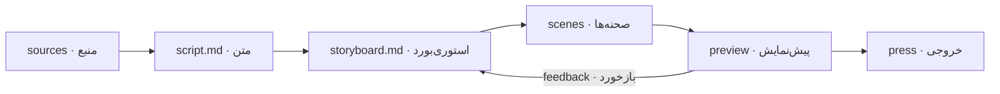
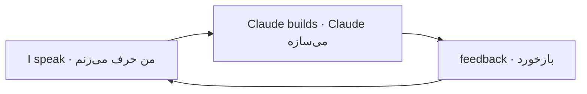

# verse-studio · starter

<div dir="rtl">

یه ستاپ ساده برای ساختن ویدیو و موشن درباره‌ی کتاب‌ها و ایده‌ها با **Claude Code**.
من ویدیوهای [@verseofali](https://www.instagram.com/verseofali) رو با همین روش می‌سازم.
اینجا فقط روش کار، اسم ابزارها و پرامپت‌ها هست؛ سبک و محتوای هر کس مال خودشه.

## پیش‌نیازها

- یه اشتراک Claude که Claude Code داره (مثلاً Pro یا Max)
- اپ دسکتاپ Claude، یا Claude Code توی ترمینال
- حدود ۵ تا ۷ گیگ فضای خالی (بیشترش برای مدل Whisper)
- مک، ویندوز یا لینوکس

## قدم به قدم

1. **Claude Code رو آماده کن.** اپ دسکتاپ Claude رو نصب کن، یا Claude Code رو از [راهنمای رسمی](https://docs.claude.com/en/docs/claude-code/overview) نصب کن.
2. **یه پوشه‌ی خالی بساز** به اسم `verse-studio`.
3. **فایل سبکت رو بنویس.** یه فایل `STYLE.md` توی همون پوشه بساز (قالبش پایین همین صفحه هست): رنگ‌ها، فونت‌ها، لحن، و چیزهایی که نمی‌خوای.
4. **پوشه رو توی Claude Code باز کن.**
5. **پرامپت رو بفرست.** محتوای [`PROMPT.md`](PROMPT.md) رو کپی کن و برای Claude بفرست.
6. **صبر کن.** Claude ابزارها رو چک و نصب می‌کنه، ساختار پوشه‌ها رو می‌سازه و یه تست ۵ ثانیه‌ای رندر می‌کنه.
7. **تست رو ببین.** اگه متن (مخصوصاً فارسی) درست نمایش داده شد، استودیوت آماده‌ست.

## ساختار

</div>

```
verse-studio/
├── CLAUDE.md          ← how Claude works here: rules and workflows
├── STYLE.md           ← your style (in my studio it's called ALISH.md)
├── inkwell/           ← shared assets
│   ├── fonts/
│   ├── paper/         ← textures, grain, torn edges, tape
│   ├── portraits/     ← your photos and cutouts
│   └── sounds/        ← pen scratch, paper, soft music
├── stamps/            ← reusable scenes: title card, plate, quote card, CTA
├── margins/           ← references you study (never reused)
└── plates/            ← one folder per video
    └── plate-001_my-first-video/
        ├── sources/       ← the article, book notes, quotes
        ├── script.md      ← narration
        ├── storyboard.md  ← scene by scene
        ├── footage/       ← your recordings and voice (read-only)
        ├── scenes/        ← the HyperFrames / Remotion code
        └── press/         ← final exports
```

<div dir="rtl">

## ابزارها

| ابزار | کارش | لینک |
|---|---|---|
| FFmpeg | برش و خروجی گرفتن | [ffmpeg.org](https://ffmpeg.org) |
| Whisper | متن و زیرنویس از صدا | [openai/whisper](https://github.com/openai/whisper) · [whisper.cpp](https://github.com/ggml-org/whisper.cpp) |
| yt-dlp | دانلود رفرنس، فقط برای مطالعه | [yt-dlp](https://github.com/yt-dlp/yt-dlp) |
| Remotion | ساختن ویدیو با کد | [remotion.dev](https://www.remotion.dev) |
| HyperFrames | موشن‌گرافیک با HTML | [heygen-com/hyperframes](https://github.com/heygen-com/hyperframes) |

## روند کار

</div>





<div dir="rtl">

## یه مثال: از یه لینک تا یه ویدیو

فرض کن یه مقاله‌ی Substack خوندی و می‌خوای ازش یه موشن ۶۰ ثانیه‌ای بسازی. اینا رو به ترتیب به Claude بگو:

1. **پلیت جدید بساز.**
   `Make a new plate called plate-002_<short-name> for this article: <link>`
   Claude پوشه رو می‌سازه و متن مقاله رو توی `sources/` ذخیره می‌کنه. اگه مقاله پشت paywall بود، خودت متن رو توی `sources/article.md` بذار.
2. **متن رو بنویس.**
   `Write a 60-second script for this plate: the core argument, one personal insight, and a question at the end.`
   نتیجه توی `script.md` میاد. حتماً خودت ویرایشش کن تا صدای خودت باشه.
3. **استوری‌بورد.**
   `Make the storyboard, scene by scene with timings, following STYLE.md.`
   تأییدش کن یا بگو چی عوض بشه.
4. **ساخت صحنه‌ها.**
   `Build the scenes with HyperFrames and show me a preview.`
5. **بازخورد.** مثلاً: «صحنه‌ی ۳ خیلی سریعه» یا «نقل‌قول رو بزرگ‌تر کن».
6. **خروجی.**
   `Render it at 1080×1920 to press/.`
7. **صدا.** صدات رو توی CapCut روی ویدیو ضبط کن، یا فایل صدات رو توی `footage/` بذار و از Claude بخواه زیرنویس و هم‌زمانی رو انجام بده.

همیشه اسم نویسنده رو روی صفحه بیار و تیکه‌های طولانی از متن اصلی رو کپی نکن.

## قالب STYLE.md

</div>

```markdown
# STYLE — <your name>

## Essence
<one sentence: what your videos feel like>

## Voice
- Language and tone (e.g. spoken, first person, short sentences)
- How you open (e.g. a question in the first 3 seconds)
- What every video must carry (e.g. one personal insight)

## Palette
| Role        | Hex       |
|-------------|-----------|
| Background  | #…        |
| Text        | #…        |
| Accent      | #…        |

## Type
| Use              | Font |
|------------------|------|
| Titles           | …    |
| Body / subtitles | …    |
| Labels           | …    |

## Motion rules
- Pace, scene length, transitions you allow

## Sound
- Voice first; what goes underneath

## Formats and safe zones
- Reel 1080×1920: keep text between y 250 and y 1500
- YouTube 1920×1080

## Never
- Things you never want to see in your videos
```

<div dir="rtl">

## نکته‌ها

- `yt-dlp` فقط برای مطالعه‌ی رفرنس‌هاست. هیچ‌وقت فیلم، موسیقی یا صدای کس دیگه‌ای رو توی کارت استفاده نکن.
- Whisper فارسی رو خوب می‌فهمه ولی بی‌نقص نیست؛ متن رو همیشه چک کن، مخصوصاً اسم‌ها.
- Remotion برای افراد و تیم‌های تا ۳ نفر رایگانه. HyperFrames متن‌باز (Apache 2.0) و رایگانه.
- کار با Claude Code از سقف استفاده‌ی اشتراک Claude کم می‌کنه؛ ساخت ویدیو نسبت به متن مصرف بیشتری داره.

</div>

---

## English (short)

A small Claude Code setup for making videos and motions about books and ideas.

**Steps:** install Claude Code (or the Claude desktop app) → create an empty
`verse-studio` folder → write your own `STYLE.md` (template above) → open the
folder in Claude Code → paste [`PROMPT.md`](PROMPT.md) → Claude installs FFmpeg,
Whisper, yt-dlp, Remotion and HyperFrames, builds the folders and renders a
5-second test.

**One video = one plate:** `sources → script.md → storyboard.md → scenes →
preview → press`, with your feedback in between.

**Rules:** references are for study only; credit authors; check transcripts.

Made by [@verseofali](https://www.instagram.com/verseofali).
